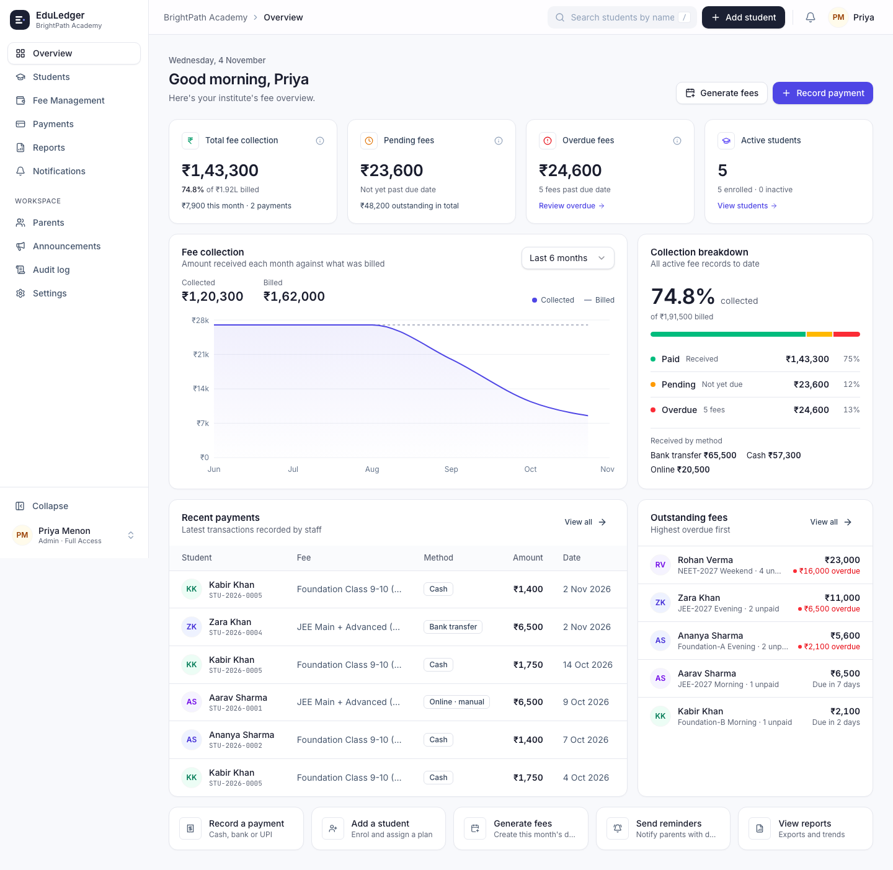
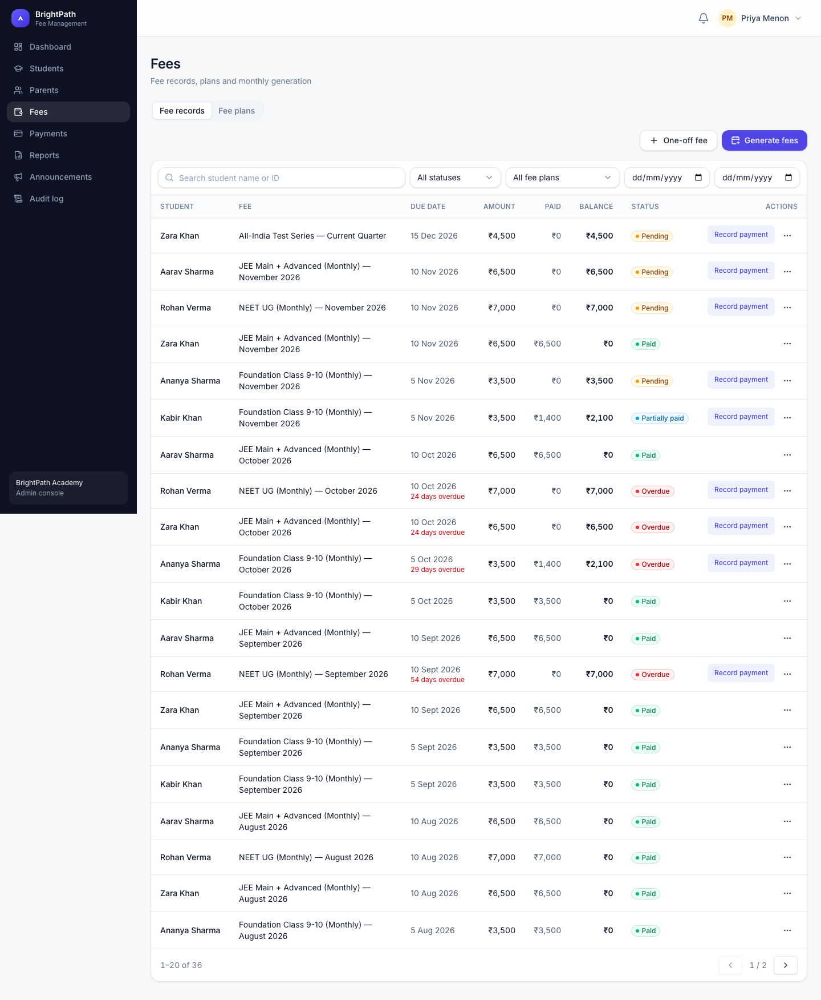
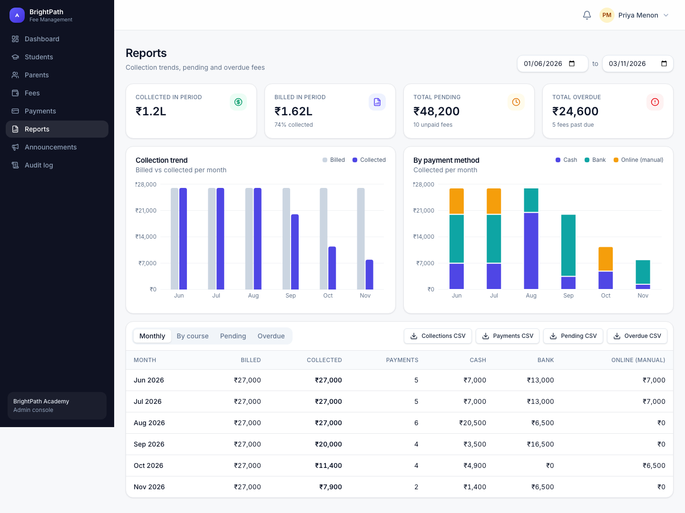
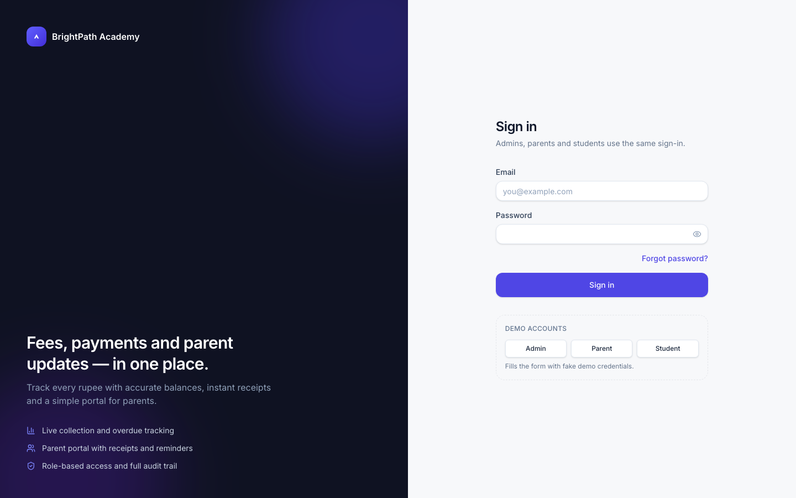
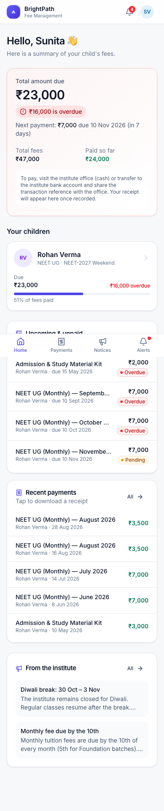
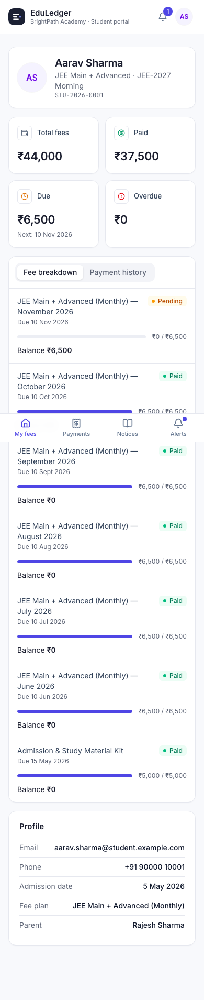
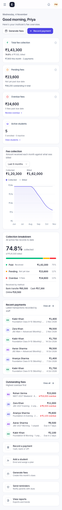

# EduLedger — Coaching Institute Fee Management & Parent Portal

EduLedger is a full-stack (MERN + TypeScript) system for a coaching institute (demo institute: BrightPath Academy) to manage students, fee plans, fee records, payments and receipts, with a separate portal for parents and students.

**Live app:** https://coaching-fee-management.vercel.app (demo logins are in [docs/deployment.md](docs/deployment.md)).

Every financial calculation happens on the backend. Amounts are stored as **integer paise**. The backend enforces role-based access on every endpoint: a parent can only ever see their own linked children.

> All names, emails and phone numbers in the demo data are fictional.

---

## Features

**Admin console**
- Dashboard: total students, collected / pending / overdue amounts, a 6-month billed-vs-collected chart, recent payments, students with outstanding fees, and quick actions.
- Students: add, edit, archive (soft delete that keeps payment history), search, filter by course / batch / status / fee status, detail page with fees and payments, optional student login.
- Parents: create accounts, link and unlink children, disable or enable accounts, issue single-use password-reset links.
- Fees: fee plans (monthly, quarterly or one-time). Idempotent fee generation per month, one-off fees, editing (amount can never drop below what is already paid), and cancelling (only fees with no payments).
- Payments: record cash, bank-transfer or **online (manual entry)** payments. Partial payments are supported. Overpayment and duplicate submissions are blocked. Every payment gets a unique transaction ID and a downloadable PDF receipt.
- Reports: monthly collections, breakdown by payment method and by course, pending and overdue lists, a date-range filter, and CSV exports.
- Notifications and announcements: in-app fee-due, overdue and payment-received notifications. Announcements can target everyone, parents only or students only.
- Audit log: who did what and when, for every financial and administrative change.

**Parent portal** (mobile-first, with a bottom tab bar on phones)
- Welcome screen showing the total due, the overdue amount and the next deadline.
- A card for each child with progress, a fee breakdown and payment history.
- PDF receipt download, upcoming deadlines, notifications and announcements.

**Student portal**
- Profile, fee status and breakdown, payment history with receipts, announcements and notifications.

**Not included:** there is no real payment gateway. Online payments are recorded manually by staff and are labelled that way everywhere, including on receipts. Nothing is ever claimed as gateway-verified.

---

## Screenshots

| Admin dashboard | Fee records |
|---|---|
|  |  |

| Reports | Login |
|---|---|
|  |  |

| Parent (mobile) | Student (mobile) | Admin (mobile) |
|---|---|---|
|  |  |  |

---

## Tech stack

| Layer | Tech |
|---|---|
| Frontend | React 19, TypeScript, Vite, Tailwind CSS v4, shadcn-style components on Radix UI, Lucide icons, React Router 7, Redux Toolkit, Axios, React Hook Form + Zod, Recharts, Sonner toasts |
| Backend | Node.js, Express 5, TypeScript, Mongoose 8, Zod, JWT (HS256), bcrypt (`bcryptjs`, 12 rounds), Helmet, CORS allow-list, express-rate-limit, PDFKit |
| Database | MongoDB Atlas (any replica set). Local dev can run on an in-memory replica set. |
| Testing | Jest + Supertest (38 API tests), Playwright (6 E2E tests on desktop and mobile) |
| Deploy | Vercel (client and API), MongoDB Atlas. A Render blueprint is included as an alternative for the API. |

```
coaching-fee-management/
├── client/            React app (src/components, pages, layouts, features, hooks, services, store, types, utils)
├── server/            Express API (src/config, controllers, middleware, models, routes, services, validators, utils, seed, tests)
├── e2e/               Playwright specs
├── docs/              TDD.md, deployment.md, screenshots
├── render.yaml        Render blueprint for the API (alternative host)
└── playwright.config.ts
```

---

## Getting started

**Prerequisites:** Node.js 20 or later and npm. MongoDB is optional; see option A.

```bash
git clone <repo-url> coaching-fee-management
cd coaching-fee-management
npm run install:all
cp server/.env.example server/.env   # then fill in values (see below)
```

### Option A: zero setup (no MongoDB install)

```bash
npm run dev:memory
```

This starts an **in-memory MongoDB replica set** (so transactions work), seeds the demo data on first run, and starts the API on `:5001` and the web app on http://localhost:5173. Data persists in `server/.mongo-data` between runs. To start again with fresh data, run `RESEED=true npm run dev:memory`.

> `server/.env` still needs a `JWT_SECRET` of at least 32 characters.

### Option B: your own MongoDB or Atlas

Set `MONGODB_URI` in `server/.env`, then run:

```bash
npm run seed     # WIPES the target database and loads demo data
npm run dev      # API :5001 + web :5173 (Vite proxies /api to the API)
```

### Environment variables

`server/.env` (see `server/.env.example`)

| Name | Purpose |
|---|---|
| `NODE_ENV` | `development` / `production` |
| `PORT` | API port (default 5001) |
| `MONGODB_URI` | MongoDB connection string |
| `JWT_SECRET` | Signing secret, at least 32 characters |
| `JWT_EXPIRES_IN` | Token lifetime, e.g. `1d` |
| `CLIENT_URL` | Allowed CORS origin(s), comma-separated; also used to build reset links |
| `INSTITUTE_NAME` | Shown on receipts |
| `INSTITUTE_TZ_OFFSET_MINUTES` | Institute timezone offset for due dates (330 = IST) |
| `REMINDER_DAYS_BEFORE_DUE` | Window for "due soon" reminders |

`client/.env` (see `client/.env.example`)

| Name | Purpose |
|---|---|
| `VITE_API_URL` | API base URL, e.g. `https://your-api.vercel.app`. Leave empty in local dev. |

---

## Demo credentials

| Role | Email | Password | Notes |
|---|---|---|---|
| Admin | `admin@brightpath.edu` | `Admin@123` | Full access |
| Parent | `rajesh.sharma@example.com` | `Parent@123` | Aarav (JEE) and Ananya (Foundation) |
| Parent | `sunita.verma@example.com` | `Parent@123` | Rohan (NEET), who has several overdue fees |
| Parent | `imran.khan@example.com` | `Parent@123` | Zara (JEE) and Kabir (Foundation, partial payments) |
| Student | `aarav.sharma@student.example.com` | `Student@123` | |
| Student | `ananya.sharma@student.example.com` | `Student@123` | |
| Student | `rohan.verma@student.example.com` | `Student@123` | |
| Student | `zara.khan@student.example.com` | `Student@123` | |
| Student | `kabir.khan@student.example.com` | `Student@123` | |

The login page has one-click buttons that fill in the admin, parent and student demo accounts.

The seed data is generated relative to today: 6 months of fees, 36 fee records, 31 payments, partial payments, overdue and upcoming fees, announcements and notifications. This keeps the dashboard realistic whenever you seed it.

---

## Testing

```bash
npm test            # Jest + Supertest against an in-memory replica set (38 tests)
npm run test:e2e    # Playwright: boots a fresh seeded API + web app (6 tests, desktop + mobile)
```

The API tests cover:
- authentication and the password-reset flow
- role-based access and IDOR protection
- student creation and archiving
- fee generation, including idempotency and quarterly plans
- overdue calculation
- partial payments down to the paisa, overpayment rejection and idempotent duplicates
- concurrent payment races
- PDF receipts
- the audit trail and NoSQL-injection rejection

The E2E tests cover four flows:
- admin creates a student
- admin records a payment and downloads the receipt
- parent views their child's fee status
- parent is blocked from another parent's child, both in the UI and directly via the API

---

## API overview

All responses use the same envelope: `{ success: true, data, meta? }` or `{ success: false, error: { code, message, details? } }`. All amounts are integer paise.

| Module | Endpoints |
|---|---|
| `/api/auth` | `POST /login`, `POST /logout`, `GET /me`, `POST /forgot-password`, `POST /reset-password`, `POST /change-password` |
| `/api/users` (admin) | `GET /`, `PATCH /:id/status`, `POST /:id/reset-link` |
| `/api/students` | `GET /` (admin; search, filter, paginate), `GET /filters`, `POST /`, `GET /me` (student), `GET /:id` (admin, owning parent or self), `PATCH /:id`, `DELETE /:id` (archive), `POST /:id/account` |
| `/api/parents` | `GET /me/dashboard` (parent), `GET /`, `POST /`, `GET /:id`, `PATCH /:id`, `POST /:id/students`, `DELETE /:id/students/:studentId` |
| `/api/fees` | `GET/POST /structures`, `PATCH/DELETE /structures/:id`, `POST /generate`, `GET /records` (scoped to the caller), `POST /records`, `GET /records/:id`, `PATCH /records/:id`, `POST /records/:id/cancel` |
| `/api/payments` | `GET /` (scoped to the caller), `POST /` (admin), `GET /:id`, `GET /:id/receipt` (PDF) |
| `/api/notifications` | `GET /`, `PATCH /:id/read`, `PATCH /read-all`, `POST /reminders/run` (admin) |
| `/api/announcements` | `GET /` (filtered by audience), `POST /`, `PATCH /:id`, `DELETE /:id` |
| `/api/reports` (admin) | `GET /dashboard`, `GET /collections`, `GET /pending`, `GET /overdue`, `GET /export?type=collections\|payments\|pending\|overdue`, `GET /audit-logs` |

See [docs/TDD.md](docs/TDD.md) for the design and [docs/deployment.md](docs/deployment.md) for deployment.

---

## Known limitations

- **No email or SMS.** Notifications are in-app only. "Forgot password" does not send email; admins issue single-use reset links from the Parents screen, and in development the link is also written to the server log.
- **No payment gateway.** Online payments are entered manually after staff check them.
- **No refunds or voided payments.** Payments are append-only. A correction requires adjusting the fee amount, which is audited.
- **Reminder job runs in-process** every 6 hours. On free hosting tiers that sleep, use the "Send fee reminders" button or an external cron job.
- **JWT is stored in browser storage** (`localStorage` with "Keep me signed in", otherwise `sessionStorage`) to support the web app and API running on different origins. See the trade-offs in TDD.md.
